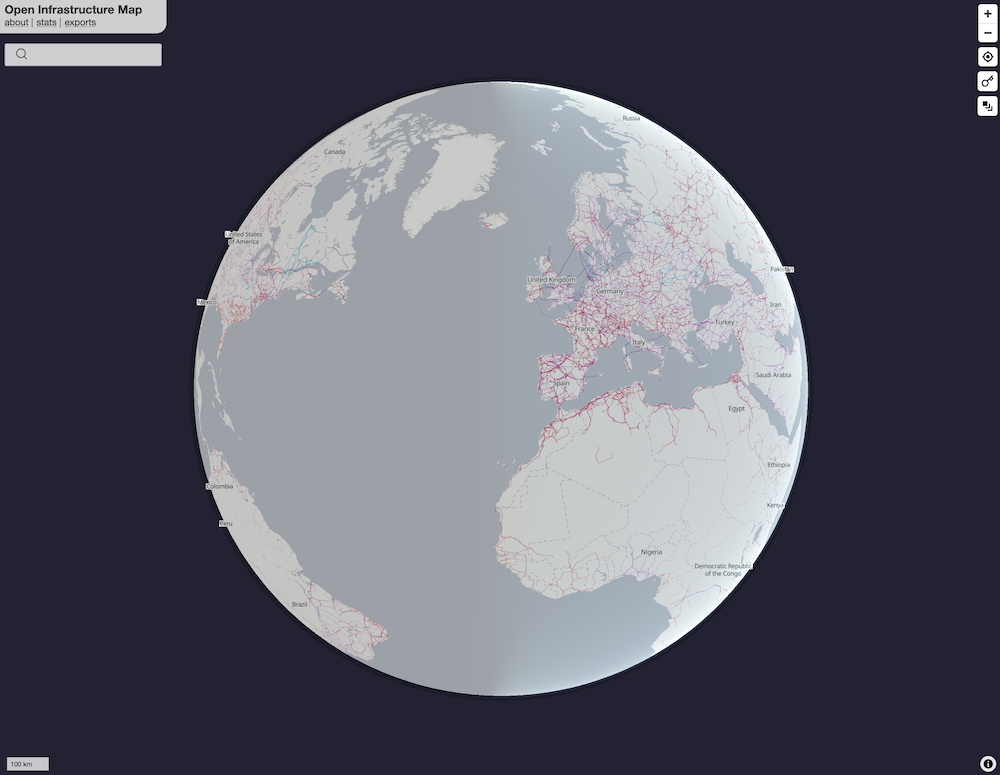

# Open Infrastructure Map (Fork)

This is a fork of [Open Infrastructure Map](https://github.com/openinframap/openinframap), a map showing the world's
infrastructure from [OpenStreetMap](https://www.openstreetmap.org).



## Changes from upstream

- **Satellite imagery background** -- Added ESRI World Imagery as a selectable background layer in the layer switcher, alongside the existing OpenStreetMap and Nighttime Lights options. Translations included for all 24 supported locales.

- **Docker dev environment fixes** -- Fixed database initialization (extension permissions, SQL function ordering) and service startup race conditions so `docker compose up` works reliably from a clean state.

- **Automated dev setup** -- Added `dev-setup.sh` to automate the full local development pipeline: downloading an OSM extract, importing data, creating database views, and starting all services. Detects host CPU architecture (`linux/arm64` vs `linux/amd64`) and runs PostGIS/imposm natively (multi-arch PostGIS + imposm built from source) so Apple Silicon avoids QEMU crashes.

- **Full local stack** -- Added `web-backend` service to Docker Compose and Vite proxy configuration so stats pages, search, and other backend routes work in local development.

- **Power plant filters** -- Filter power plants by source (Solar, Wind, Coal, Gas, Nuclear, Hydro) and substations by type (Transmission, Distribution, Traction, DC Converter, Transition, Other). Power plants are color-coded by source on the map. Filter power lines by voltage/rating: &lt; 10 kV, 10–52 kV, 52–132 kV, 132–220 kV, 220–345 kV, 345+ kV, HVDC, Traction.

> *"But wait, there's more! You get satellite imagery, a fully automated dev setup, AND a working Docker stack -- all for the low, low price of one `git clone`!"* -- Billy Mays (probably)

## Quick start

```bash
# Clone and set up (defaults to Texas OSM extract):
./dev-setup.sh

# Or use a custom Geofabrik region:
./dev-setup.sh https://download.geofabrik.de/europe/monaco-latest.osm.pbf

# Start the web frontend:
cd web && npm install && npm run dev
```

Dev setup creates search indexes automatically so typeahead search works. For a clean re-import (e.g. different PBF), run `./dev-setup.sh` again; it tears down volumes and re-imports from scratch.

## Upstream links

- [Open Infrastructure Map](https://openinframap.org)
- [Upstream repository](https://github.com/openinframap/openinframap)
- [IRC: #osm-infrastructure](https://webchat.oftc.net/?channels=osm-infrastructure) | [Matrix](https://matrix.to/#/#osm-infrastructure:matrix.org)
- [Translations on Weblate](https://hosted.weblate.org/engage/open-infrastructure-map/)

## Development

For details on how to develop Open Infrastructure Map, see the [architecture documentation](./docs/architecture.md). See [satellite imagery](./docs/satellite-imagery.md) for how imagery is updated and how to use a different provider.

- **Search indexes**: Dev setup runs `create_indexes.py` so search works. To re-run only the indexes (e.g. after changing `web-backend/views/search.py`), from the project root:  
  `docker compose run --rm -e ADMIN_DATABASE_URL=postgresql://osm:osm@db:5432/osm web-backend uv run python create_indexes.py`
- **Tests**: From `web/`, run `npm run test` (expects the dev server on port 5173), or `npm run test:e2e` to start the server, run tests, then exit.
